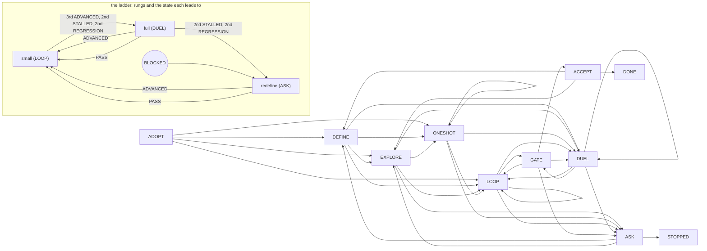

# cLoop — Claude Code edition

**cLoop** is a council loop for coding agents. The *c* stands for **council**: cLoop is short for *council-Loop*, and everywhere else it is simply cLoop.

You state the goal. A council of two independent models helps turn it into a rubric of single-property criteria, tagged CORE or NON-CORE. The root builds the whole product as one self-contained one-shot and runs it on real input; then one next-shot repairs what failed and moves it into the architecture's layout. The council judges every step against the whole rubric on a committed candidate. When a failure resists the root, the same two models become loop-breakers; when they cannot close it either, you decide a re-plan. Nothing counts as done until the release gate passes: the product end to end on a real run, the full suite, and a full review.

This `claude` branch runs everything in **Claude Code**: the root is a Claude Code session and every member, explorer and builder is a native subagent launched with the `Agent` tool and an explicit `model` and `effort`. No Codex needed.

## What is new in 1.2.3: the prevent, enforced in every working state

1.2.2 asked for a prevent (a step back, then the one-block) before every step, but the engine checked it only in the one-shot, the next-shot and part of explore. 1.2.3 enforces it everywhere, from one rule in `flow.json` (`prevent`).

- **Where.** Adoption (before the baseline run), define (before the freeze; the members may draft once the step back is recorded), explore, the one-shot, every next-shot, the duel, the re-define and the release gate. The state's first work command (a run, a call, a judgment, a freeze, an approval) is refused until the prevent is recorded, and the state's exit checks it again. Each refusal names the command that records the missing part.
- **What is owed.** A one-shot and explore owe only the step back (the one-shot is its own block). The duel's loop-breakers each owe their own full step back and one-block, which the root records from each reply (`stepback full --call <id>`, `block --call <id>`) before running or judging that result: a record of what the loop-breaker wrote, not a witness that it did the work. The re-define's new definition is the re-plan's one-block, recorded before your yes; once you approve, it is also the prevent of the state it leads to.
- **Tasks saved by 1.2.2 continue.** A task loaded mid-state owes the prevent from its next state entry.

## What is new in 1.2.2: one climb, and a prevent before every step

1.2.0 moved every instruction into cards and the flow into data. 1.2.2 changes the flow itself, so the model builds the way it builds best: one coherent block at a time.

- **One climb instead of two stages.** The core stage, the core gate and the separate non-core stage are gone: the build is one features stage that ends at one end-to-end gate. CORE and NON-CORE stay as rubric classes.
- **One-shot, then one next-shot.** The one-shot builds the whole product as one self-contained file, with every core and non-core criterion, and the council judges it: it passes when every core criterion works. Then the next-shot, ONE small loop, repairs every failing criterion and moves the one-shot into the architecture's layout in the same block, never a chain of repair loops followed by a refactor. The release gate refuses until a next-shot has passed.
- **A prevent before every step.** Every loop, shot and phase starts with a step back on the whole, then a one-block: the next action written whole on the board (`block`, shown under `## Next action`) before anything is built. A one-shot is its own block; DEFINE drafts spec, architecture and rubric together as one block.
- **The council judges everything.** The one-shot, every next-shot and the release gate are judged on every criterion.
- **Focused and full climb the same way.** Only FULL may explore.
- **The re-define asks you twice, in plain words:** first your comment, then your yes to the plan it produced, with what differs from your comment marked. A no with a new comment starts the re-plan again.
- **Safer when `.git` is read-only.** The task's own store keeps your checkout's branch, cannot push anywhere, and is probed before use; at acceptance you are told where the work is.
- **Tasks started on 1.2.0 continue.** Their state migrates on load.

## How it works

<!-- flow:start (generated from flow.json by tools/flow-diagram.mjs; do not edit) -->

<!-- flow:end -->

## Why cLoop

Models have three default habits: they add where they should delete, they fix details where they should look at the whole, and they satisfy the measure where they should satisfy the goal. cLoop counters each one with mechanics, not exhortation:

- **Step backs on the whole.** Every step opens with a step back that reads all the evidence, names the class of failure and its root cause, considers removal first, and decides one correction for the whole property; then the next action is written whole, as one block, before anything is built. The step back comes in three sizes: yours in a few paragraphs, the loop-breakers' in a page, and a re-plan you approve.
- **Real runs, not proxies.** A passing test is not rubric satisfaction, and agreement between judges is not evidence. Every MET names the nearest counterfeit it excludes and a boundary case that was run; a violation counts only once the root reproduces it.
- **One-shot, then one next-shot.** A single self-contained file shows early whether the approach is right; one next-shot then repairs and refactors it in one block, never a long chain of patches. An unsound one-shot is shot again.
- **Escalate only as far as the failure requires.** Progress keeps the root on the small rung; repeated stalls or regressions bring in the loop-breakers; only what they cannot close comes to you.
- **Cheap mechanics first.** Town Council is built to run real work on small accounts; High Council spends more where the task is hardest.

## The method in one screen

```text
ROUTE    DIRECT (one local edit) | FOCUSED: DEFINE → CLIMB | FULL: DEFINE → EXPLORE (when triggered) → CLIMB
ADOPT    an existing project is adopted first: keep, simplify or replace, with you
DEFINE   goals with you → spec, architecture and rubric as one block, drafted by both members → CORE / NON-CORE → freeze
         (provisional until the first council, then frozen hard; changes need your words)
EXPLORE  2–4 parallel single-file one-shots, judged blind; the engine computes the eligible; the root chooses
PREVENT  every loop, shot and phase: a step back on the whole, then the next action as one block;
         the engine refuses each working state's first work command until it is recorded
CLIMB    one-shot (one file) → council → next-shot (repair + refactor) → release gate (end to end)
ACCEPT   the release gate passed: you accept, or your feedback goes back to DEFINE or EXPLORE

LADDER   small: your prevent + the next attempt    (3rd ADVANCED, 2nd STALLED or REGRESSION → full)
         full: two loop-breakers, one merge         (ADVANCED → small; 2nd STALLED or REGRESSION → re-define)
         re-define: your comment → their re-plan → your yes   (ADVANCED → small)
```

Outcomes are PASS, ADVANCED, STALLED, REGRESSION or BLOCKED, computed by the engine. After every judging the root sends you `node .cloop/cloop.mjs report` and keeps working.

## Profiles

| Profile | Council | Root (recommended) | Member A | Member B | Explorer | Account |
| --- | --- | --- | --- | --- | --- | --- |
| `town` | Town Council | Opus 5.5 medium | Sonnet 5.5 xhigh | Opus 5.5 medium | Sonnet 5.5 medium | Claude Max |
| `high` | High Council | Opus 5.5 high | Opus 5.5 xhigh | Fable 5.1 xhigh | Opus 5.5 medium | Claude Max (higher tier) |

Install **exactly one** profile per project. Member A and Member B judge every loop and every gate, and become the loop-breakers when a failure resists the root.

Both members come from the same lab on this branch, so every review names the nearest counterfeit (what could look like the property without being it) with extra care.

## Editions

| Branch | Root | Members and explorers |
| --- | --- | --- |
| `main` | Claude Code | Member A native subagent; Member B and explorers through Codex CLI |
| `codex` | Codex | native Codex subagents |
| `claude` | Claude Code | native Claude Code subagents |

Every branch carries the same method, engine, flow and cards at 1.2.3. Only the roles subsection of the profile, the installer target and the builders' invocation differ.

## For AI coding agents (Claude Code, Codex, Cursor, OpenCode)

If a human asked you to install cLoop into the **current** project:

1. cLoop is project-local. Never install into a home config and never treat it as a global skill.
2. Ask which profile to use if they did not name one (`town` or `high`); recommend from the table above.
3. Clone this repository and check out the branch that matches their harness (`main`, `codex` or `claude`). Profiles live next to `install.mjs`.
4. Run the installer with Node 18+ from the target project:

```bash
node /path/to/cLoop/install.mjs install --project . --profile town
```

5. Do not paste profile text into `CLAUDE.md` yourself, and do not install more than one profile.
6. After install or update, tell the human to open the project in Claude Code, accept the workspace trust dialog, review `/hooks`, and set the root model with `/model` (`town`: Opus 5.5 medium; `high`: Opus 5.5 high).

## Install / update / doctor / uninstall

In an existing project, the first FOCUSED or FULL task starts with ADOPTION: `node .cloop/cloop.mjs init` detects the project and enters ADOPT, so the rubric, the spec and the architecture exist before feature work. `doctor` checks that the installed engine, flow and cards match this checkout.

```bash
node /path/to/cLoop/install.mjs install --project . --profile town
node /path/to/cLoop/install.mjs update --project . [--profile high]
node /path/to/cLoop/install.mjs doctor --project .
node /path/to/cLoop/install.mjs uninstall --project .
```

Flags: `--dry-run`, `--force` (overwrite a hand-edited cLoop block), `--json`, `--no-hooks`, `--hooks` (default), `--builders none|cheap|cheap-100`. `--global` is rejected. Profile aliases: `town-council`, `high-council`.

**Requirements:**
- Node 18+ and Claude Code.

## What it writes

```text
CLAUDE.md                        # bounded cLoop block appended or replaced
.cloop/cloop.mjs                 # the engine the policy runs (node .cloop/cloop.mjs status)
.cloop/flow.json                 # the flow it interprets
.cloop/cards/                    # the cards it binds to states and roles
.cloop/state.json                # profile, hashes, hook mode
.claude/settings.json            # cLoop hook entries merged into "hooks"; other keys kept
.claude/hooks/cloop-turn.mjs     # heartbeat (UserPromptSubmit) + short compact reminder (SessionStart: compact)
```

Claude Code re-reads the project-root `CLAUDE.md` after compaction, so the compact hook injects only the turn reminder, never the whole block. Everything outside the `<!-- cloop:managed:start -->` / `<!-- cloop:managed:end -->` markers stays yours; `uninstall` removes only cLoop files.

While a task runs, the engine keeps `cloop/state.json`, `cloop/log.jsonl` (every run, call, judging, step back and transition) and the rendered `cloop/board.md`; calls live in `cloop/runs/` and `cloop/wt/`, scratch in `temporary/`. All are git-excluded; `node .cloop/cloop.mjs clean` removes the call folders, worktrees and scratch after DONE and keeps the state, log and board. Three files are permanent and committed: `cloop/rubric.md`, `cloop/spec.md` and `cloop/architecture.md`. Where the sandbox keeps `.git` read-only, `init` keeps the repository in `cloop/git`, with its history; run git through `node .cloop/cloop.mjs git <args>`.

## cheapGPT builders (`--builders`)

cLoop and [cheapGPT](https://github.com/Lycvrgvs/cheapGPT) are never installed in the same project. To get cheapGPT's economical builders, install cLoop with `--builders cheap` or `--builders cheap-100`. The builders then take only the build steps (each one-shot file and each small loop's build): each is one native subagent for the whole task, seeded with a conversation packet and continued through `SendMessage`, and takes every assignment in its own worktree of BEST (`node .cloop/cloop.mjs call dynamic|mechanical`, whose packet carries the builder's card); the root allocates by whether the handoff can state the exact result, merges, and runs the real path before the council. The root keeps everything else, and the council never changes. Pick the builders separately from `town` or `high`.

| Option | Dynamic builder | Mechanical builder |
| --- | --- | --- |
| `--builders none` (default) | the root builds | the root builds |
| `--builders cheap` | Sonnet 5.5 medium | Haiku 5.5 xhigh |
| `--builders cheap-100` | Sonnet 5.5 xhigh | Haiku 5.5 xhigh |

The rows come from cheapGPT 1.10.2's published `profiles/roles.json` (the `claude-edition` edition), copied into `vendor/cheapgpt-builders.json` at release time. Nothing is fetched at install.

```bash
node /path/to/cLoop/install.mjs install --project . --profile town --builders cheap
node /path/to/cLoop/install.mjs update --project . --builders none   # back to root-built steps
```

`update` keeps the recorded value until you pass another one. When cheapGPT is installed, `install` and `update` stop before writing anything and print the commands to keep one package. To move a cheapGPT project to cLoop, uninstall cheapGPT with its own installer first, then install cLoop with the matching `--builders` value.

## Tests

```bash
node --test test/*.mjs
node tools/flow-diagram.mjs --check   # the README diagram matches flow.json
```

## Releasing

Profiles are generated, never edited by hand. To release a new prompt, on each branch run:

```bash
node tools/sync-builders.mjs --roles /path/to/cheapGPT/profiles/roles.json --commit <cheapGPT sha>
node tools/release.mjs --txt /path/to/cloop-town.txt --version X.Y.Z
node tools/flow-diagram.mjs
node --test test/*.mjs
```

`sync-builders` copies the builder rows from cheapGPT's published roles table, checked out at a pinned commit of the paired edition. `release` then derives the six profiles for this branch's edition (`town`, `high`, each with builders `none`, `cheap` and `cheap-100`) from the Town Council source prompt, the mono-agent `cloop-town.txt`. It refuses to run if the prompt's roles subsection or intro no longer match its template. Keep the released `cloop.mjs`, `flow.json` and `cards/` next to `install.mjs`; the installer ships them to `.cloop/`.

## Layout

```text
install.mjs              zero-dependency installer
cloop.mjs                the engine: runs flow.json, binds the cards, enforces the guards
flow.json                states, transitions, guards, commands, ladder and card bindings
cards/*.md               the instructions for each state and each sub-agent
profiles/town.md         Town Council policy (generated)
profiles/high.md         High Council policy (generated)
profiles/*.cheap*.md     the same policies with a Builders block (generated)
profiles/catalog.json    profile metadata and turn reminders (generated)
hooks/cloop-turn.mjs     copied into each target project's .claude/hooks/
tools/release.mjs        profile generator for releases
tools/sync-builders.mjs  copies cheapGPT's builder rows into vendor/
tools/flow-diagram.mjs   writes the README diagram from flow.json
vendor/cheapgpt-builders.json  vendored builder rows and their cheapGPT source
cheapgpt-guard.mjs       stops install and update when cheapGPT is installed
test/installer.test.mjs  the installer
test/repo.test.mjs       flow.json, the cards and the README diagram
test/cloop.test.mjs      the engine: every guard refusing once, then passing; the git store; migration
```
